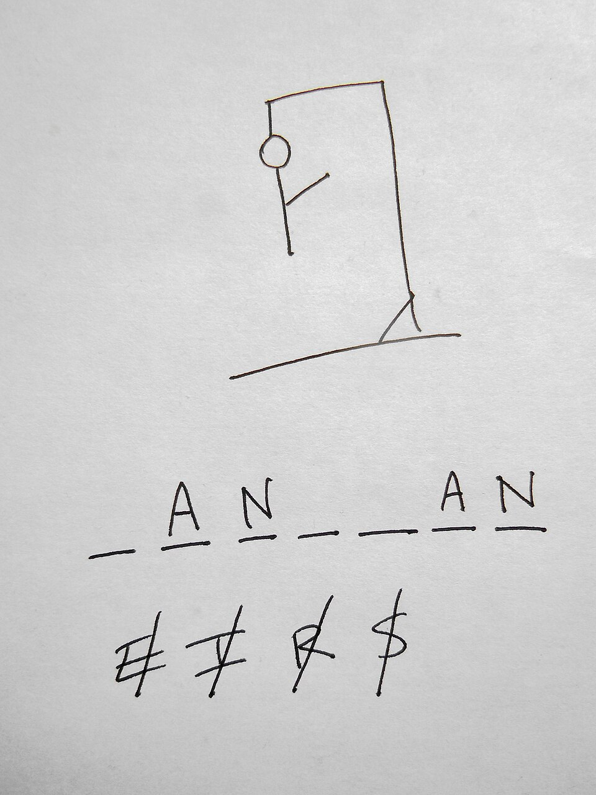

# Hangman game

### Hangman is a classic word-guessing game 

## How to play
1) Preparing:
    * Clone the [project](https://github.com/Sss330/hangman.git) to local machine
    * Launch the game
      * Open the project as maven-project, choose JDK, launch main() in hangman.Main, the working directory is the root of the project  
2) Rules
   * You have 6 attempts to guess the guessed word
   * Type a letter and press Enter to make a guess
   * You win when you guessed a full word 
   * You lost when you exhausted 6 attempts
3) Demands
   * JDK 22 or newer
4) FYI
   * The game entirely in English
   * You can enter only one letter at a time
   * Register doesn't matter
   * Repeat of already entered a wrong letter doesn't affect the error counter  
